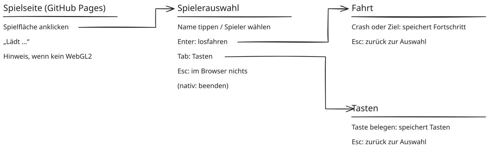
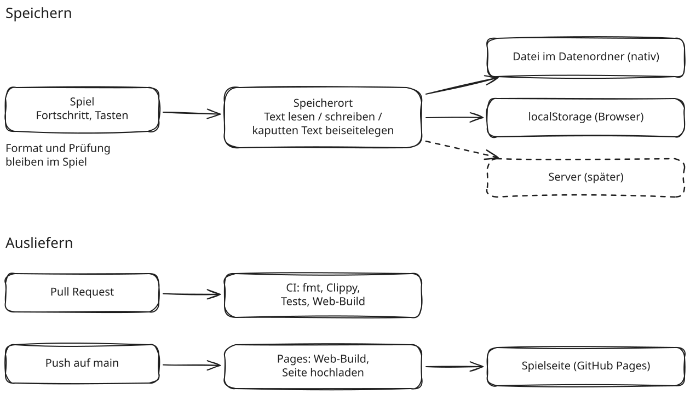

# Problem

Moto Devil läuft nur als native Anwendung. Wer es ausprobieren will, braucht
Rust, die richtige Toolchain und unter NixOS eine `nix-shell`, und muss das Spiel
selbst bauen. Freunde mit einem Link zum Mitfahren einzuladen geht nicht.

Ein Browserspiel ohne Spielstand würde aber den Kern verlieren: Grabsteine,
geschaffte Länder und die eigenen Tasten. Heute schreibt `save.rs` fest in
Dateien im Datenordner, und ADR 0005 hält ausdrücklich fest, dass ein Web-Build
keinen Fortschritt behielte. Kommt später ein zentraler Speicher dazu (Spielstand
auf mehreren Geräten, Grabsteine anderer sehen), soll dafür nicht wieder jede
Stelle angefasst werden, die heute Dateien kennt.

Dazu kommt: Es gibt keine CI. Ob `main` baut und die Tests grün sind, weiss nur,
wer lokal `mise run check` ausführt. Mit einem Web-Build kommt ein zweites Ziel
dazu, das lokal leicht vergessen geht.

# Lösung

**Moto Devil wird zusätzlich als statische Webseite gebaut und bei jedem Push auf
`main` auf GitHub Pages veröffentlicht. Spielstand und Tasten gehen über einen
kleinen Speicherort, der nativ Dateien und im Browser `localStorage` nutzt.
Pull Requests prüft eine CI.** Im Browser ist es dasselbe Spiel: gleiche Levels,
gleiche Physik, gleiche Tasten.

## Spielen im Browser

Quelle: [breadboard.excalidraw](breadboard.excalidraw).

- **Ankommen.** Der Link öffnet eine schlichte Seite mit der Spielfläche im
  Seitenverhältnis 16:9. Sie wächst mit dem Fenster und steht mittig auf dunklem
  Grund. Bis das Spiel geladen ist, steht dort „Lädt …“.
- **Fokus.** Ein Klick in die Spielfläche gibt ihr die Tastatur. Pfeiltasten,
  Leertaste und Tab scrollen dann nicht die Seite, sondern steuern das Spiel.
- **Kein WebGL2.** Ein Browser ohne WebGL2 bekommt einen kurzen Hinweis statt
  einer leeren Fläche.
- **Danach** kommt die bekannte Spielerauswahl: Name tippen oder wählen, Enter
  zum Losfahren, Tab für die Tasten. Crash, Ziel und neu belegte Tasten werden
  gespeichert wie nativ.
- **Esc auf der Spielerauswahl** beendet nativ das Spiel. Im Browser würde das
  die Spielfläche einfrieren, deshalb tut Esc dort nichts. Man schliesst den Tab.

## Der Speicherort

Quelle: [speichern-und-ausliefern.excalidraw](speichern-und-ausliefern.excalidraw).

- **Was gespeichert wird, bleibt gleich.** Zwei Texte: der Fortschritt im
  Format `moto-devil-save 1` und die Tasten. `encode`, `decode` und alle
  Prüfungen bleiben in `progress.rs` und `bindings.rs`. Es gibt kein neues
  Format und keine Migration.
- **Neu ist ein Speicherort** als Ressource mit drei Fähigkeiten: den Text eines
  Eintrags lesen (oder „gibt es nicht“), einen Text schreiben und einen kaputten
  Eintrag beiseitelegen. Es gibt genau zwei Einträge, Fortschritt und Tasten.
  `SavePlugin` kennt nur noch den Speicherort, keine Pfade.
- **Nativ** bleibt alles wie heute: `progress.txt` und `keys.txt` im Datenordner,
  atomar geschrieben, kaputte Dateien werden zu `.broken`. Vorhandene Spielstände
  werden unverändert gelesen.
- **Im Browser** sind die Einträge die `localStorage`-Schlüssel
  `moto-devil/progress` und `moto-devil/keys`. Kaputte Einträge wandern nach
  `moto-devil/progress.broken`. Die Grössengrenzen gelten wie bei Dateien.
  `localStorage` ist synchron, also passt es zum heutigen Ablauf: laden beim
  Start, schreiben in `Last`, wenn sich etwas geändert hat. Ein geschlossener Tab
  verliert nichts, was schon geschrieben wurde.
- **In Tests** gibt es einen Speicherort im Arbeitsspeicher. Damit lässt sich
  `SavePlugin` headless prüfen: Laden, Schreiben und Beiseitelegen ohne
  Temp-Verzeichnis.
- **Welcher Speicherort gilt**, entscheidet `main.rs` beim Zusammenbauen, nach
  Zielplattform. Die Simulation bleibt davon unberührt.
- **Später ein Server.** Der Speicherort spricht nur Texte, keine Spielregeln.
  Ein Server-Speicherort könnte im Browser in `localStorage` puffern und im
  Hintergrund abgleichen, ohne dass das Spiel warten muss. Dafür wird jetzt
  nichts gebaut, auch keine asynchrone Schnittstelle auf Vorrat.

Die Abstraktion ist eine dauerhafte Entscheidung und ändert eine Konsequenz von
ADR 0005. Sie bekommt deshalb ein eigenes ADR, das ADR 0005 ergänzt.

## Bauen für das Web

- Dasselbe Crate wird zusätzlich für `wasm32-unknown-unknown` gebaut. Es gibt
  kein zweites Crate und keine Kopie von `main.rs`. Was nur im Browser gilt
  (Spielfläche im Canvas, Speicherort, Esc), steht hinter der Zielplattform.
- Gerendert wird mit WebGL2. Das reicht für die einfachen 2D-Formen und läuft in
  allen aktuellen Desktop-Browsern.
- Die Schrift ist schon ins Programm kompiliert, und weitere Dateien gibt es
  nicht. Die Seite lädt also nur `index.html`, das JavaScript-Glue und die
  `.wasm`-Datei. Damit funktioniert sie auch unter dem Unterpfad
  `/moto-devil/` von GitHub Pages.
- Ein kleines, handgeschriebenes `index.html` liegt im Repo. Die mise-Tasks
  `web:build` (erzeugt einen Ordner mit der fertigen Seite) und `web:serve`
  (zum lokalen Ausprobieren) kommen neu dazu. CI und Pages rufen dieselben Tasks
  auf wie man lokal.

## CI und Auslieferung

- **CI** läuft auf jedem Pull Request und jedem Push auf `main`: Formatierung,
  Clippy, Tests und der Web-Build. Die Tests sind headless und brauchen keine
  GPU. Die GPU-Aufnahmen bleiben opt-in und laufen in der CI nicht.
- **Pages** läuft bei jedem Push auf `main` und auf Knopfdruck: Web-Build, Seite
  als Pages-Artefakt hochladen, veröffentlichen. Es gibt immer nur eine
  Veröffentlichung gleichzeitig, eine neuere ersetzt eine laufende.
- Einmalig von Hand: In den Repo-Einstellungen wird „GitHub Actions“ als
  Pages-Quelle gewählt.
- `CONTRIBUTING.md` und die Architekturdoku beschreiben danach CI, Web-Build und
  Auslieferung. Der Satz „There are no CI workflows yet“ fällt weg.

## Woran wir den Versuch beurteilen

- Link öffnen, einen Namen mit Umlaut tippen, ein Level fahren, crashen, den Tab
  schliessen und wieder öffnen: Der Spieler und sein Grabstein sind noch da.
- Tasten umbelegen und die Seite neu laden: Die Belegung bleibt.
- Das Spiel läuft in aktuellem Firefox und Chrome auf dem Desktop flüssig und
  fühlt sich an wie nativ.
- Nativ ändert sich nichts. Eine vorhandene `progress.txt` wird gelesen.
- Ein Pull Request zeigt das CI-Ergebnis, ein Push auf `main` aktualisiert die
  Seite.

# Sicherheit

- **`localStorage` ist unsichere Eingabe**, genau wie eine Datei. Es gelten
  dieselbe Grössengrenze vor dem Lesen und dasselbe defensive `decode`. Ein
  kaputter Eintrag wird beiseitegelegt, nicht weiter benutzt.
- **Gemeinsamer Ursprung.** Alle Projektseiten eines Kontos teilen sich den
  Ursprung `https://<konto>.github.io`, also auch seinen `localStorage`. Andere
  Pages-Seiten des Kontos können die Moto-Devil-Einträge lesen und überschreiben.
  Drin stehen nur Spielernamen und Level-Fortschritt, und das Lesen ist ohnehin
  defensiv. Das wird hingenommen; das Präfix `moto-devil/` vermeidet
  versehentliche Kollisionen. Eine eigene Domain würde das lösen und ist hier
  ein No-Go.
- **Keine Daten verlassen das Gerät.** Das Spiel macht keine Netzwerkaufrufe.
  Die Seite lädt keine fremden Skripte, Schriften oder Analytics; alles kommt
  vom selben Ursprung.
- **Workflows mit knappen Rechten.** Standard ist nur Lesezugriff auf den Inhalt.
  Nur der Veröffentlichungsjob bekommt `pages: write` und `id-token: write`. CI
  läuft auf `pull_request`, nicht auf `pull_request_target`, damit fremder Code
  keine Rechte bekommt. Veröffentlicht wird nur von `main`. Es gibt keine
  Secrets. Benutzt werden nur offizielle `actions/*` und wenige verbreitete
  Actions (mise, Rust-Cache), mit fester Version.

# Rabbit Holes

- **Privates Repo und Pages.** Das Repo ist privat. GitHub Pages für private Repos
  braucht einen bezahlten Plan, und die Seite ist trotzdem öffentlich. Vor dem
  Bauen klären: Repo öffentlich machen oder einen Plan mit Pages. Zugriffsschutz
  für die Seite gibt es in diesem Pitch nicht.
- **`wasm-bindgen`-Version.** Das CLI muss exakt zur Version von `wasm-bindgen`
  in `Cargo.lock` passen. Es wird über mise in genau dieser Version gepinnt.
  Kein Trunk, kein `wasm-pack`, kein Bundler.
- **Grösse der Seite.** Bevy und Rapier ergeben mehrere Megabyte WASM. Der
  Web-Build optimiert auf Grösse (eigenes Release-Profil, LTO, `wasm-opt`, wenn es
  ohne Aufwand geht). Das genügt. Kein Aufteilen, kein Streaming-Trick, kein
  Abspecken der Bevy-Features über das Nötige hinaus. „Lädt …“ deckt die
  Wartezeit ab.
- **Tastatur im Browser.** Bevy fängt auf der Spielfläche die Standardaktionen
  des Browsers ab. Das ist gewollt, sonst scrollen Pfeile und Leertaste, und Tab
  springt aus dem Spiel. Dass dabei auch Browserkürzel wie F5 nicht greifen,
  solange die Spielfläche den Fokus hat, wird hingenommen.
- **Umlaute beim Namen.** Die Namenseingabe liest den getippten Text aus
  `KeyboardInput`. Mit deutschem und Schweizer Layout und Tottasten im Browser
  prüfen. Keine IME-Unterstützung, keine Bildschirmtastatur.
- **Hintergrund-Tab.** Ein Browser pausiert versteckte Tabs. Beim Zurückkommen
  darf der feste Zeitschritt nicht Sekunden nachholen und das Bike in eine Falle
  schicken. Bevys Obergrenze für die Zeit pro Frame sollte reichen. Einen
  eigenen Pausenmodus gibt es nur, wenn das beim Ausprobieren nicht genügt.
- **`localStorage` fehlt oder ist voll** (privater Modus, gesperrter Speicher,
  Kontingent). Das Spiel läuft dann ohne Speichern weiter, mit einer Warnung in
  der Konsole, wie heute ohne Datenordner. Es gibt keine Meldung im Spiel und
  keinen Ersatzspeicher.
- **Zwei Tabs.** Wer zuletzt schreibt, gewinnt. Kein Abgleich zwischen Tabs über
  `storage`-Events.
- **Mehrere Threads.** Pages kann die Header COOP/COEP nicht setzen. Das Spiel
  läuft im Browser in einem Thread. Kein Service-Worker-Trick, um die Header
  nachzurüsten.
- **CI-Umgebung.** `.cargo/config.toml` linkt unter Linux mit clang und lld, und
  Bevy braucht ALSA-, udev-, Wayland- und xkbcommon-Header. Der Runner installiert
  genau das, und ein Rust-Cache verkürzt die Läufe. Keine Matrix über
  Betriebssysteme, keine weitere Optimierung der Laufzeit.
- **Speicher-Framework.** Keine generische Key-Value-Schicht, keine asynchrone
  Schnittstelle auf Vorrat, kein `serde`, keine Versionierung pro Speicherort.
  Zwei Einträge, drei Fähigkeiten.

# No-Gos

- Keine Touch- oder Handysteuerung. Gespielt wird im Desktop-Browser mit
  Tastatur, ein Gamepad nur, wenn der Browser es ohnehin meldet.
- Kein zentraler Speicher, kein Server, keine Konten und kein Abgleich zwischen
  Geräten.
- Kein Export oder Import des Spielstands im Browser.
- Kein IndexedDB und kein Bevy-`SettingsPlugin`.
- Keine Änderung am Format von Spielstand oder Tasten.
- Kein Azure, keine eigene Domain und keine Vorschau-Seiten pro Pull Request.
- Kein WebGPU-Build, kein Mehrthread-Build.
- Keine Landingpage, kein Vollbild-Knopf, kein Seitendesign über Spielfläche,
  „Lädt …“ und den WebGL2-Hinweis hinaus.
- Keine nativen Release-Builds oder Downloads aus der CI.
- Keine Änderungen an Levels, Physik oder Abstimmung für den Browser.
