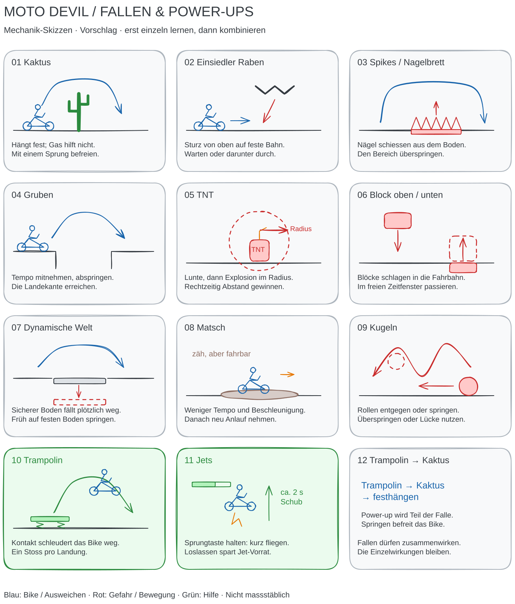
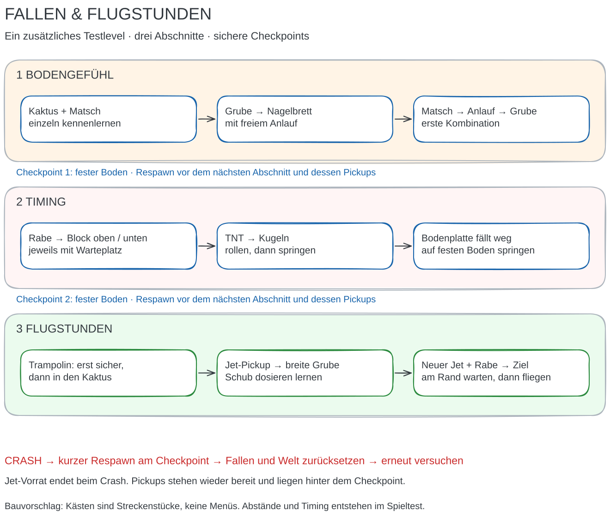

# Problem

Moto Devil lebt davon, dass man eine Falle erlebt, ihren Trick versteht und beim
nächsten Versuch weiterkommt. Die zwei bestehenden Levels zeigen dieses Prinzip,
aber die Antworten wiederholen sich: springen, weiterfahren, neu versuchen.
Es fehlen Hindernisse, die Tempo und Flugbahn verändern, und Hilfen, mit denen man
gefährliche Stellen auf eine neue Art überwinden kann.

Ein Kaktus soll einen festhalten, Matsch den Anlauf verderben und ein Rabe von oben
zum Ausweichen zwingen. Gleichzeitig sollen Trampolin und Jets das Bike über die
normalen Sprungmöglichkeiten hinausbringen. Die Herausforderung ist, daraus
lernbaren Slapstick zu machen: überraschend beim ersten Mal, verständlich und
schaffbar beim nächsten.

# Lösung

**Ein zusätzliches, kurzes Testlevel „Fallen & Flugstunden“ mit neun Fallenarten
und zwei Power-ups.** Jede Mechanik bekommt zuerst eine übersichtliche Stelle;
danach verbinden Kombinationen die gelernten Antworten: Fallen können gemeinsam
auftreten, und auch ein Power-up kann einen direkt in eine Falle befördern. Bestehende Fallen
werden wiederverwendet. Die Umsetzung ist in der
[Architektur](../../architecture/README.md#contact-effects-and-flight) dokumentiert.

Die Begriffe aus der Ideensammlung sind hier so verstanden: „Raben von open“
heisst **Einsiedler Raben von oben**; das Trampolin **spickt das Bike weg**.

## Mechaniken auf einen Blick

Bearbeitbare Quelle: [mechaniken.excalidraw](mechaniken.excalidraw).
Die Pfeile zeigen Bewegung oder eine mögliche Ausweichroute; gestrichelte Formen
zeigen spätere Positionen beziehungsweise einen Wirkungsbereich. Die Skizzen
legen weder Abstände noch Geschwindigkeiten fest.

| Falle | Was passiert? | Was kann der Spieler tun? |
| --- | --- | --- |
| **Kaktus** | Berührt ein Rad den Kaktus, bleibt das Bike hängen und verliert seinen Vortrieb, auch bei einer Landung nach einem Flug. Der Kaktus allein verursacht keinen Crash. | Vorher darüber springen. Wer festhängt, kann sich mit einem Sprung lösen; Gas allein reicht nicht. |
| **Einsiedler Raben** | Ein Rabe stürzt von oben auf eine festgelegte Stelle der Strecke und fliegt anschliessend hinaus. Ein Treffer am Bike oder Fahrer verursacht einen Crash. | Vor dem Sturz bremsen und warten oder rechtzeitig unter der Flugbahn hindurchfahren. Der Rabe verfolgt das Bike nicht nachträglich. |
| **Spikes / Nagelbrett** | Ein Nagelbrett schiesst aus dem Boden, sobald das Bike die Auslösezone erreicht. Ausgefahrene Nägel verursachen bei Berührung einen Crash. | Die Stelle im nächsten Versuch überspringen; die Strecke lässt vor dem Brett genügend Anlauf. |
| **Gruben** | Die Fahrbahn ist unterbrochen. Wer die gegenüberliegende Kante verfehlt und unter die Fallgrenze fällt, crasht. | Mit passendem Anlauf darüber springen. Sichere Absprung- und Landeflächen machen die Aufgabe lesbar. |
| **TNT** | Nähe zündet eine kurze Lunte. Danach ist ein Kreis um die Kiste kurz gefährlich; Bike oder Fahrer innerhalb des Explosionsradius crashen. | Den Radius rechtzeitig verlassen oder ausserhalb warten. Die Explosion ist auch ohne Berührung der Kiste gefährlich. |
| **Block von oben / unten** | Ein Block fällt aus der Decke oder schiesst aus dem Boden in die Fahrbahn. Sein bewegter Gefahrenbereich verursacht einen Crash. Nach einer kurzen Haltezeit fährt er zurück. | Vor dem Bewegungsbereich warten oder im freien Zeitfenster passieren. Beide Richtungen werden einzeln eingeführt. |
| **Dynamische Welt** | Eine zunächst sichere Bodenplatte klappt beziehungsweise fällt nach dem Auslösen weg und öffnet eine Grube. Die Veränderung läuft beim gleichen Auslöser immer gleich ab, nach dem Vorbild von Level Devil. | Früh abspringen und auf dem dauerhaft sicheren Boden landen. Die veränderte Strecke bleibt bis zum nächsten Versuch so. |
| **Matsch** | Solange ein Rad den Matsch berührt, sinken Beschleunigung und erreichbares Tempo deutlich. Das Bike kann weiterfahren und springen. | Den Streifen überspringen oder bewusst langsam durchfahren und danach neuen Anlauf nehmen. |
| **Kugeln** | Eine Kugel rollt dem Bike entgegen. Eine zweite Variante springt beim Aufprall auf den Boden wieder hoch und kommt in Bögen näher. Kontakt verursacht einen Crash. | Die rollende Kugel überspringen; bei der springenden Variante eine Lücke abwarten oder unter einem hohen Bogen hindurchfahren. |

## Power-ups

**Trampolin — ein Stoss, dann wieder normale Fahrt.** Berührt ein Rad das
Sprungtuch von oben, schleudert es das ganze Bike in die eingezeichnete Richtung.
Das geschieht automatisch; Kippen bleibt während des Flugs möglich. Ein Pfeil am
Trampolin zeigt, ob es senkrecht oder schräg wirft. Erst nach dem Verlassen und
erneuten Landen kann dasselbe Trampolin wieder auslösen. Es addiert nicht in jedem
Moment weiteren Schub. Der erste Aufbau wirft über eine Grube auf eine breite,
sichere Landefläche.

**Jets — ein kurzer, steuerbarer Flug.** Ein sichtbarer Jet-Pickup gibt dem Bike
einen zeitlich begrenzten Flugvorrat. Solange der Vorrat reicht, aktiviert das
Halten der Sprungtaste beziehungsweise der Süd-Taste den Aufwärtsschub. Loslassen
unterbricht den Schub und spart den Rest; Kippen richtet das Bike aus, vorhandenes
Vorwärtstempo bleibt erhalten. Der Schub geht für den ersten Versuch immer nach
oben, unabhängig vom Neigungswinkel. Es gibt keine neue Taste. Ohne Jet-Vorrat
gilt wieder der normale Bodensprung. Ein Vorratsbalken mit der Beschriftung „Jet“
zeigt den Rest an; sichtbare Düsen zeigen, wann der Schub aktiv ist.

Als erster Spieltestwert reichen ungefähr **zwei Sekunden Gesamtschub**, um eine
breitere Grube zu überfliegen. Dauer, Schub und Streckenbreite werden gemeinsam im
Spiel abgestimmt. Jets geben keine Unverwundbarkeit. Ein weiterer Pickup füllt
höchstens auf einen vollen Vorrat auf, statt Flugzeit unbegrenzt zu stapeln.

## Fallen kombinieren

Fallen dürfen gleichzeitig wirken oder direkt aufeinander folgen. Power-ups sind
dabei keine Garantie für eine sichere Passage: Ein hilfreicher Stoss kann Teil
eines Tricks sein.

**Trampolin → Kaktus:** Nach dem ersten sicheren Trampolin folgt ein zweites,
das das Bike direkt in einen Kaktus schleudert. Bei der Landung bleibt es hängen.
Mit der Sprungtaste befreit sich der Spieler und landet auf sicherem Boden neben
dem Kaktus. So wird dieselbe Hilfe zur Falle, ohne neue Regeln einzuführen.

Weitere Kombinationen sind Matsch vor einer Grube, ein Rabe während eines
Jet-Flugs oder eine Kugel neben einem zuschlagenden Block. Bei gleichzeitig
aktiven Fallen muss ein gemeinsames Zeitfenster oder ein sicherer Weg bleiben.
Der Testumfang enthält ausgewählte Kombinationen; weitere können beim Levelbau
aus denselben Bausteinen entstehen.

## Gemeinsame Spielregeln

- **Lernbare Auslöser.** Aktive Fallen starten durch eine feste Zone; Position,
  Verzögerung und Ablauf sind je Stelle vorgegeben. Kaktus, Matsch und Trampolin
  reagieren auf Kontakt. Gruben sind Streckengeometrie. Raben und Kugeln werden
  erst beim Annähern losgeschickt, nicht durch eine globale Uhr.
- **Ein lesbarer Hinweis.** Raben sind vor dem Sturz oben im Bild sichtbar;
  Blöcke haben eine erkennbare Führung, TNT eine brennende Lunte. Matsch und
  Kaktus unterscheiden sich durch Form und Verhalten. Hinweise dürfen dezent
  sein, müssen aber nach dem ersten Fehlversuch die Ursache erklären. Farbe und
  Ton sind nie die einzigen Hinweise.
- **Eine Antwort bleibt möglich.** Vor jeder Gefahr gibt es einen Absprungpunkt,
  einen Warteplatz oder einen Weg aus dem Wirkungsbereich. Keine Kette aus
  Kaktus und unmittelbar tödlicher Falle, der man nach dem Festhängen nicht mehr
  entkommen kann. Sich mit Springen aus einem Kaktus zu lösen, gilt unabhängig
  davon, ob gerade ein normaler Bodenkontakt erkannt wird.
- **Behinderung endet sauber.** Nach dem Freisprung greift derselbe Kaktus erst
  wieder, wenn das Bike seinen Bereich verlassen hat und erneut hineinfährt.
  Matsch bremst nur bei Kontakt; ausserhalb gelten sofort die normalen Fahrwerte,
  verlorenes Tempo muss man wieder aufbauen. Mehrere Kontakte verstärken den
  Effekt nicht unkontrolliert.
- **Neuer Versuch, gleiche Ausgangslage.** Beim Crash und beim Levelneustart
  werden Fallen, bewegte Weltteile, Raben und Kugeln zurückgesetzt. Festhängen,
  Matschwirkung und Jet-Vorrat enden; Pickups sind wieder verfügbar. Checkpoints
  stehen vor einem Abschnitt samt benötigtem Power-up, damit kein Respawn einen
  unerreichbaren Pickup hinter dem Spieler voraussetzt.
- **Wirkungen gelten auch kombiniert.** Fallen dürfen gemeinsam auftreten;
  Trampolin und Jet dürfen ebenfalls zusammen wirken. Der Trampolinstoss
  verbraucht keinen Jet-Vorrat. Ein Trampolinflug schützt nicht vor dem Festhängen
  im Kaktus. Eine aktive tödliche Gefahr bleibt auch mit
  Power-up tödlich; ein gleichzeitiger Pickup verhindert keinen Crash.

## Ein spielbarer Umfang

Bearbeitbare Quelle: [teststrecke.excalidraw](teststrecke.excalidraw).
Die Kästen stehen für kurze Streckenstücke, nicht für zusätzliche Menüs.

Das neue Level wird an die bestehenden zwei Levels angehängt und besteht aus
drei kurzen Abschnitten. Die Checkpoints begrenzen Wiederholungen auf den gerade
gelernten Abschnitt; R bleibt der Neustart des gesamten Levels.

1. **Bodengefühl.** Kaktus und Matsch einzeln auf flachem Boden kennenlernen.
   Danach eine kleine Grube und ein Nagelbrett mit ausreichend Anlauf. Abschluss:
   Matsch vor einer Grube, mit einer sicheren Fläche dazwischen zum erneuten
   Beschleunigen. Ein Checkpoint folgt auf festem Boden.
2. **Timing.** Ein Rabe, ein Block von oben, ein Block von unten und TNT kommen
   nacheinander mit Warteplätzen. Danach eine rollende und eine springende Kugel,
   jeweils einzeln. Eine wegfallende Platte über einer Grube bildet den letzten
   Trick. Dahinter liegt der zweite Checkpoint.
3. **Flugstunden.** Erst das Trampolin über eine Grube mit breiter Landung.
   Danach schleudert ein zweites Trampolin das Bike in einen Kaktus; ein
   Befreiungssprung führt auf sicheren Boden. Anschliessend der Jet-Pickup vor
   einer breiteren Grube, die mit normalem Sprung nicht
   überquert werden kann. Vor der letzten Flugpassage füllt ein zweiter Pickup
   den Vorrat wieder auf. Dort kreuzt ein bereits bekannter Rabe die Flugstrecke:
   seinen Sturz am sicheren Rand abwarten, dann mit dem Jet fliegen und auf festem
   Boden zum Ziel fahren. Beide Pickups liegen hinter dem Checkpoint.

Die Reihenfolge ist ein Bauvorschlag. Wichtiger als viele Meter Strecke ist, dass
jede Mechanik allein verstanden werden kann, bevor eine Kombination folgt.
Einzelne Wiederholungen können beim Spieltest entfallen; alle neun Fallenarten
und beide Power-ups bleiben im Umfang.

## Anschluss an das bestehende Spiel

Die [aktuelle Architektur](../../architecture/README.md) und
[Leveldefinitionen](../../../src/level.rs) enthalten bereits Gruben, ausfahrende
Spikes, TNT mit Explosionsradius, fallende Platten und eine fallende beziehungsweise
wieder steigende Säule. Die [Fallensysteme](../../../src/traps.rs) setzen diese
bei einem neuen Versuch zurück. Diese Bausteine bilden den Ausgangspunkt; neu
sind insbesondere Kaktus, Raben, Matsch, Kugeln, der aufwärts zuschlagende Block,
Trampolin und Jets.

Die Umsetzung soll in der vorhandenen Bevy-/Rapier-Simulation bleiben. Zustände
und Wirkungen laufen im festen Zeitschritt; Eingaben kommen weiterhin über
`Controls`. Zeichnung, Hinweise und Jet-Anzeige stellen diese Zustände dar. Der
Pitch legt keine neue Komponentenstruktur fest. Architekturtexte und nötige
ADRs werden erst mit konkreten Umsetzungsentscheidungen angepasst.

## Woran wir den Versuch beurteilen

- Nach einem Fehlversuch können Testspieler die Ursache und eine mögliche
  Gegenaktion benennen. Sie schaffen jede Einzelstelle mit den vorhandenen
  Tasten, ohne Entwicklerhilfe oder einen erzwungenen Neustart wegen Festhängens.
- Kaktus hält tatsächlich fest und lässt sich per Sprung verlassen; Matsch
  verlangsamt spürbar und verändert die Fahrt ausserhalb seiner Fläche nicht
  dauerhaft. Ein sofortiges Wiederfesthalten nach dem Freisprung tritt nicht auf.
- TNT trifft im Radius, aber nicht ausserhalb; beide Blockrichtungen und beide
  Kugelvarianten lassen ein nutzbares Zeitfenster. Gleiche Annäherung ergibt
  denselben Fallenablauf.
- Das Trampolin gibt pro Landung genau einen Stoss. Jets verbrauchen Vorrat nur
  bei Schub, enden bei leerem Vorrat und lassen die normale Steuerung wieder zu.
- Die Kombination Trampolin → Kaktus schleudert das Bike in den Kaktus, hält es
  bei der Landung fest und lässt es mit einem Sprung wieder frei. Gemeinsam aktive
  Fallen behalten ihre Einzelwirkungen und einen lösbaren gemeinsamen Ablauf.
- Jeder Abschnitt bleibt nach Crash, Checkpoint-Respawn und Levelneustart lösbar.
  Keine alte Kugel, offene Bodenplatte oder fehlender Pickup überlebt versehentlich
  den Reset. Das ganze Level ist mit Tastatur und Controller durchspielbar.

Bei der Umsetzung sichern gezielte headless Verhaltenstests Auslösen, Kontaktende,
Vorratsverbrauch und Reset ab. Ob Anlauf, Hinweise und Zeitfenster verständlich
und lustig sind, wird zusätzlich im laufenden Spiel beurteilt.

# Sicherheit

Die Erweiterung nutzt fest eingebaute Leveldaten und lokale Spielzustände. Sie
führt weder Netzwerkzugriff noch externe Inhalte oder neue Benutzereingaben ein.
Power-up-Vorräte und Fallenphasen werden nicht gespeichert; der vorhandene
Spielstand merkt sich weiterhin nur den üblichen Fortschritt und die Grabsteine.
Ein neues Level erhält eine eigene stabile Kennung. Zusätzliche Berechtigungen
oder ein neues Speicherformat sind dafür nicht vorgesehen.

# Rabbit Holes

- **Beliebig veränderbare Welt.** Zerstörbares Terrain, frei bewegliche Levelteile
  und prozedurale Umbauten wären ein eigenes Projekt. Hier verändert sich nur
  eine vorbereitete Bodenplatte nach einem festen Ablauf.
- **Raben-KI.** Keine Schwärme, Wegsuche oder dauerhafte Verfolgung. Ein sichtbarer
  Rabe, eine festgelegte Sturzbahn, ein Rücksetzen beim nächsten Versuch.
- **Physik-Chaos bei Kugeln.** Wenige fest platzierte Kugeln mit abgestimmtem
  Starttempo und Rückprall. Keine zufälligen Spawns, Kugelhaufen oder unbegrenzten
  Kettenreaktionen; verlassene Kugeln werden aus dem Spiel genommen.
- **Jets werden zum zweiten Fahrmodell.** Kein frei drehbarer Raketenantrieb und
  keine neue Flugsteuerung. Zeitlich begrenzter Aufwärtsschub genügt, um den Nutzen
  auszuprobieren. Der Wechsel zwischen Sprung und Schub muss im Spieltest klar sein.
- **Zu viele Kombinationen.** Erst isolierte Stellen, dann Matsch plus Grube,
  Trampolin plus Kaktus und Rabe plus Jet. Kein vollständiges Durchtesten aller möglichen Fallenpaare als
  Voraussetzung für diesen Pitch.
- **Unklare Treffer.** Sichtbare Gefahrenfläche und tatsächlicher Trefferbereich
  müssen zusammenpassen, besonders bei Explosion, Rabenflügeln und Kugeln.
  Einfache Formen zuerst, detaillierte Animationen später.

# No-Gos

- Kein universelles Fallen- oder Skriptsystem für beliebige Spielregeln.
- Kein Level-Editor, keine zufällige Levelgenerierung und kein Nachbau kompletter
  Levels aus Level Devil.
- Keine Waffen, kein Abschiessen der Raben und keine zerstörbaren Gegner.
- Kein Inventar, Shop, Upgradebaum, permanente Power-ups oder Flug auf Vorrat
  über mehrere Leben beziehungsweise Levels.
- Keine TNT-Kettenreaktionen, Druckwellenphysik oder Simulation verformbarer Erde.
- Keine weiteren Levels, Bosskämpfe, neuen Wertungen oder Änderungen an den zwei
  bestehenden Levels als Voraussetzung für diesen Versuch.
