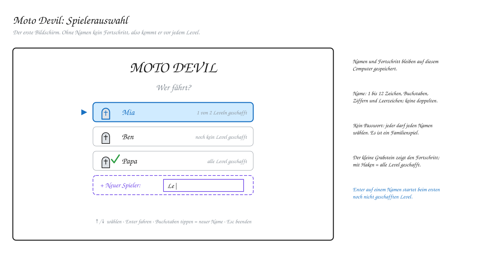
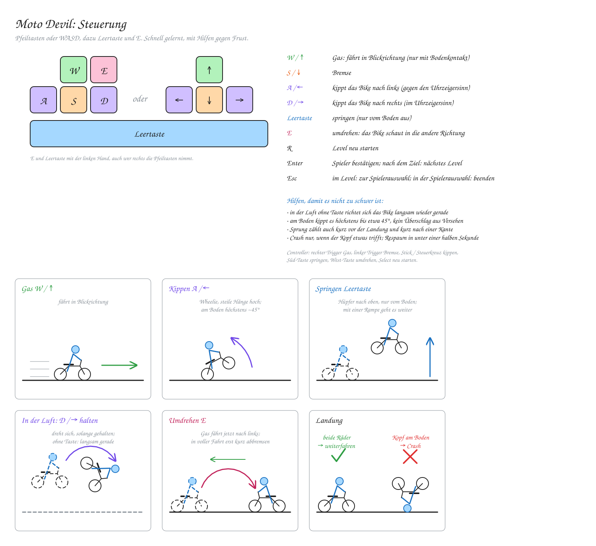
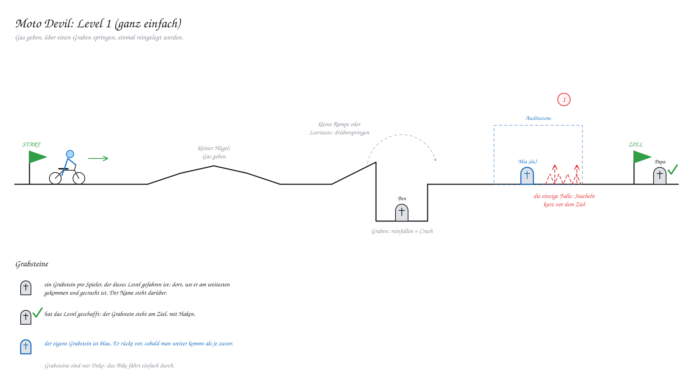
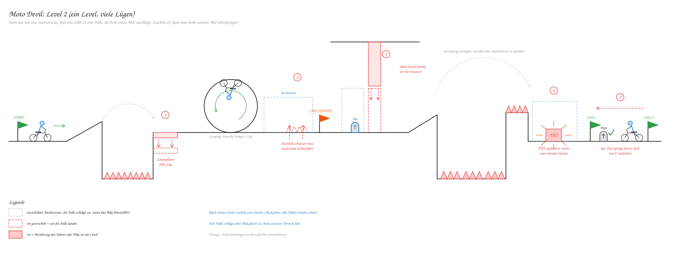
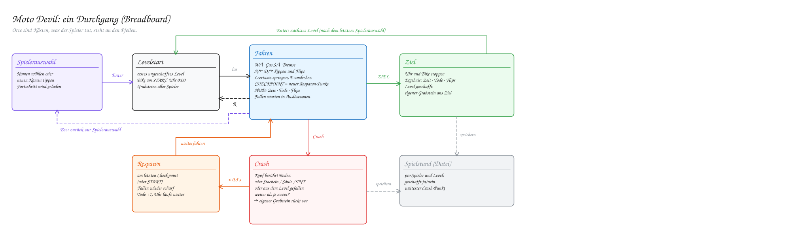

# Problem

Der Starter-Platformer ist ein Kasten, der läuft und springt. Er zeigt, wo welcher
Code hingehört, ist aber nicht das Spiel, das wir bauen wollen. Das Spiel, das
wir wollen, ist auf Papier skizziert (siehe [attachments](../attachments/)): ein
**Stuntbike-Spiel, das dich verarscht**.

- Aus dem Stuntbike-Genre (Spiele wie *Moto X3M*): ein Motorrad in Seitenansicht
  auf einer Strecke mit Rampen, Loopings und Stachelgruben. Man gibt Gas, bremst,
  kippt das Bike, landet auf beiden Rädern und macht Saltos in der Luft.
- Aus dem Troll-Platformer-Genre (Spiele wie *Level Devil*): das Level sieht
  harmlos aus und legt einen dann rein. Stacheln schiessen aus dem Boden, „wenn
  man drüber fährt“, eine Säule kracht von der Decke, eine TNT-Kiste explodiert,
  das Ziel fährt davon. Man stirbt, lacht und versucht es nochmal, um einen Trick
  schlauer.

Mehrere Leute spielen am selben Computer. Jeder soll sehen, wie weit er
gekommen ist, und auch, wie weit die anderen gekommen sind. Ohne gespeicherten
Fortschritt fängt jeder nach dem Beenden wieder bei null an, und ohne etwas
Sichtbares im Level gibt es keinen Grund, die anderen zu überholen.

Ein Bike bewegt sich ganz anders als der Kasten aus dem Starter: Es dreht sich,
folgt Schrägen und Kurven und fährt durch Loopings. Das sprengt die Annahme von
[ADR 0001](../../architecture/decisions/0001-move-the-player-with-hand-written-kinematics.md),
dass alles aus achsenparallelen Kästen besteht. Auch die Steuerung wird neu: Gas,
Bremse, Kippen, Springen und Umdrehen, und das darf nicht zu schwierig sein. Bevor
wir den Kasten ersetzen, müssen wir uns einigen, wie man das Bike steuert, wie ein Spieler zu
seinem Fortschritt kommt und was in den ersten Levels vorkommt.

# Lösung

**Moto Devil** (Arbeitstitel): Man wählt zuerst seinen Namen, dann fährt man mit
den Pfeiltasten oder WASD durch zwei Levels. Level 1 ist ganz einfach, Level 2
ist die Troll-Strecke aus den Zeichnungen. Welche Levels jemand geschafft hat,
wird gespeichert, und in jedem Level steht für jeden Spieler ein Grabstein an
der Stelle, bis zu der er gekommen ist.

## Spielerauswahl

Quelle: [name-select.excalidraw](name-select.excalidraw).

Der erste Bildschirm nach dem Start fragt „Wer fährt?“.

- Die Liste zeigt alle Spieler, die auf diesem Computer schon gespielt haben, mit
  einem kleinen Grabstein und ihrem Fortschritt („1 von 2 Leveln geschafft“).
  Wer alle Levels geschafft hat, bekommt einen Haken.
- Mit `↑`/`↓` wählt man einen Namen, `Enter` startet beim ersten Level, das
  dieser Spieler noch nicht geschafft hat. Wer schon alle geschafft hat, startet
  bei Level 1.
- Tippt man Buchstaben, entsteht in der untersten Zeile ein neuer Name. Auf diesem
  Bildschirm sind alle Buchstaben (auch `W`, `S` und `E`) und die Leertaste zum
  Tippen da, nicht zum Fahren. Erlaubt
  sind 1 bis 12 Zeichen aus Buchstaben (auch Umlaute), Ziffern und Leerzeichen;
  `Backspace` löscht. Ein Name, den es schon gibt, wählt einfach diesen Spieler aus,
  statt einen zweiten anzulegen. Gross- und Kleinschreibung zählen dabei nicht.
- Es gibt kein Passwort. Jeder darf jeden Namen wählen; es ist ein Familienspiel.
- `Esc` beendet das Spiel.

## Steuerung

Quelle: [controls.excalidraw](controls.excalidraw).

| Aktion | Tastatur | Controller |
| --- | --- | --- |
| Gas (in Blickrichtung) | `W` oder `↑` | rechter Trigger |
| Bremsen | `S` oder `↓` | linker Trigger |
| Nach links kippen (gegen den Uhrzeigersinn) | `A` oder `←` | linker Stick oder Steuerkreuz links |
| Nach rechts kippen (im Uhrzeigersinn) | `D` oder `→` | linker Stick oder Steuerkreuz rechts |
| Springen | `Leertaste` | Süd-Taste |
| Umdrehen | `E` | West-Taste |
| Level neu starten | `R` | Select |
| Spieler bestätigen; nach dem Ziel: nächstes Level | `Enter` | Süd-Taste |
| Im Level: zur Spielerauswahl; in der Spielerauswahl: beenden | `Escape` | — |

Die rechte Hand fährt mit den Pfeiltasten oder die linke mit WASD. Leertaste und
`E` liegen in beiden Fällen unter der linken Hand.

So verhalten sich die Eingaben beim Fahren:

- **Gas** treibt das Hinterrad an und fährt in die Richtung, in die das Bike
  schaut. Es schiebt nur, solange das Hinterrad den Boden berührt; in der Luft
  bewirkt Gas nichts.
- **Bremse** verlangsamt das Bike bis zum Stillstand. Rückwärts fahren gibt es
  nicht; dafür dreht man um.
- **Kippen** dreht das Bike so, wie der Pfeil zeigt: `A`/`←` kippt es nach links
  (gegen den Uhrzeigersinn), `D`/`→` nach rechts (im Uhrzeigersinn). Die Tasten
  bedeuten immer dasselbe, egal in welche Richtung das Bike schaut. Schaut es nach
  rechts, hebt `A`/`←` das Vorderrad (Wheelie, steile Hänge und Loopings hoch) und
  `D`/`→` drückt die Nase runter. In der Luft dreht sich das Bike weiter, solange
  man kippt; so entstehen Saltos.
- **Springen** mit der Leertaste ist ein Hüpfer senkrecht nach oben, immer gleich
  hoch, nur wenn mindestens ein Rad den Boden berührt. Kein Doppelsprung. Auf
  einer Rampe kommt der Sprung zum Schwung der Rampe dazu und trägt weiter. Damit
  überspringt man kleine Gräben und Stacheln, die man schon kennt.
- **Umdrehen** mit `E` dreht das Bike in die andere Richtung, sodass Gas danach
  in die neue Richtung fährt. Das geht nur am Boden. Fährt das Bike schnell,
  bremst es zuerst kurz von selbst ab und dreht sich dann; das Umdrehen dauert
  höchstens eine halbe Sekunde. In der Luft passiert nichts.
- **Gas und Kippen gleichzeitig** ist normales Fahren und muss immer gleichzeitig
  gehen, auch zusammen mit Springen. Gegensätzliche Richtungen heben sich auf:
  links und rechts zusammen heisst nicht kippen, Gas und Bremse zusammen heisst
  bremsen.
- Tasten zählen nach ihrer Position, wie im Starter, damit WASD und `E` auch auf
  anderen Tastaturbelegungen am selben Ort liegen. Nur beim Tippen eines Namens
  zählen die Zeichen, die auf der Taste stehen. `Backspace` startet nicht mehr
  neu, weil es beim Tippen löscht.
- Tasten sind an oder aus; Trigger und Stick am Controller liefern dieselben
  Aktionen auch dazwischen. Die Ressource `Controls` enthält deshalb `throttle`
  (`0..=1`), `brake` (`0..=1`), `tilt` (`-1..=1`, negativ heisst nach links),
  `jump_pressed`, `turn_pressed` und `restart`. Gedrückte Tasten für Springen,
  Umdrehen und Neustart werden gemerkt, bis ein Simulationsschritt sie verbraucht,
  wie heute beim Sprung. Eingaben erreichen die Simulation weiterhin nur über
  `Controls`
  ([ADR 0002](../../architecture/decisions/0002-keep-the-simulation-headless-behind-a-controls-resource.md)).

## Damit es nicht zu schwer ist

Die Steuerung soll man in einer Minute verstehen. Schwierig sind die Fallen,
nicht die Tasten. Deshalb hilft das Spiel mit:

- **Aufrichten in der Luft.** Drückt man in der Luft keine Kipptaste, richtet
  sich das Bike langsam wieder gerade. Wer kippt, übersteuert das sofort; Saltos
  bleiben also möglich.
- **Kein Überschlag am Boden.** Am Boden kippt das Bike höchstens bis etwa 45°.
  Ein Wheelie kann also nicht aus Versehen nach hinten überschlagen.
- **Verzeihender Sprung.** Wie im Starter zählt ein Sprung, der kurz vor dem
  Aufsetzen gedrückt wird, und einer, der kurz nach dem Verlassen einer Kante
  gedrückt wird.
- **Crash nur mit dem Kopf.** Schiefe Landungen auf den Rädern sind erlaubt.
- **Schneller Respawn.** In unter einer halben Sekunde fährt man wieder.

Wie stark diese Hilfen wirken, sind Werte zum Ausprobieren im Spiel.

## Das Bike

Zwei Räder, ein Körper und ein Fahrer mit Kopf. Die Räder berühren die Strecke;
Kopf und Körper erkennen nur Crashes. Eine Landung ist in Ordnung, solange der
Kopf nichts Festes berührt, egal in welchem Winkel die Räder aufkommen. Einen
**Crash** gibt es, wenn der Kopf Boden oder Wand berührt, wenn Fahrer oder Körper
Stacheln, eine fallende Säule oder eine Explosion berühren, oder wenn das Bike aus
dem Level fällt.

Ein **Flip** ist eine volle Drehung des Bikes in der Luft. Er zählt, wenn das Bike
danach auf den Rädern landet. Flips werden bei der Landung kurz angezeigt und für
den Durchgang gezählt. An der Zeit ändern sie nichts; ein Punktesystem kommt
später.

## Level 1: ganz einfach

Quelle: [level-1.excalidraw](level-1.excalidraw).

Level 1 bringt das Fahren bei und zeigt einmal, worum es geht:

1. Flach losfahren und Gas geben.
2. Ein kleiner Hügel.
3. Eine kleine Rampe über einen flachen Graben ohne Stacheln; wer will, springt
   zusätzlich mit der Leertaste. Wer hineinfällt, crasht und fängt von vorne an.
4. Kurz vor dem Ziel die einzige Falle: Stacheln, die aus dem Boden schiessen,
   wenn man drüberfährt. Fast jeder stirbt hier einmal und weiss danach, was für
   ein Spiel das ist.
5. Ziel.

Level 1 hat keinen Checkpoint; es ist kurz genug.

## Level 2: viele Lügen

Quelle: [level-trolls.excalidraw](level-trolls.excalidraw).

Level 2 mischt Stunt-Elemente aus den Zeichnungen mit fünf Fallen:

1. Eine Rampe über eine Stachelgrube. Die Landeplatte fällt weg, sobald das Bike
   darauf landet.
2. Ein Looping, der Tempo und Gas braucht, danach Stacheln, die aus dem Boden
   schiessen, wenn man drüberfährt. Beim zweiten Versuch springt man mit der
   Leertaste darüber.
3. Ein Checkpoint, danach eine Säule, die direkt vor dem Bike von der Decke kracht.
4. Eine Rampe über eine zweite Stachelgrube und ein Turm mit Stacheln oben drauf.
   Eine TNT-Kiste hinter dem Turm explodiert, wenn das Bike daneben landet: weiter
   springen.
5. Kurz vor der Zielflagge springt das Ziel hinter das Bike. Man dreht mit `E`
   um und fährt zurück zum echten Ziel.

## Fallen

Jede Falle ist eine **unsichtbare Auslösezone** plus eine Aktion: Fährt das Bike
in die Zone, schlägt die Falle zu (eine Platte fällt, Stacheln kommen raus, eine
Säule stürzt, TNT explodiert, die Flagge fährt weg). Fallen schlagen jedes Mal
gleich zu, ohne Zufall, damit man sie lernen und Tests sie prüfen können. Beim
Respawn werden sie wieder scharf.

Die Levels bestehen aus Linienstücken, Bögen und Rechtecken statt aus der
Tile-Map des Starters, denn eine Tile-Map kann keine Rampen, Kurven und Loopings
darstellen.

## Grabsteine

In jedem Level steht für jeden Spieler, der dieses Level schon gefahren ist, ein
Grabstein mit seinem Namen darüber (siehe die Skizze von Level 1).

- Der Grabstein steht an der **weitesten Stelle, an der der Spieler in diesem
  Level gecrasht ist**. Gemessen wird nur, wie weit rechts die Stelle liegt;
  der Stein steht auf der Strecke darunter.
- Crasht man weiter vorne als je zuvor, **rückt der eigene Grabstein vor**,
  sofort im Level und im Spielstand.
- Wer das Level **geschafft** hat, dessen Grabstein steht am Ziel, mit einem
  grünen Haken. Er rückt danach nicht mehr zurück.
- Der **eigene Grabstein** ist blau, die der anderen sind grau.
- Grabsteine sind nur Deko: Sie haben keine Kollision, und das Bike fährt durch
  sie hindurch.
- Wer ein Level noch nie gefahren ist oder dort noch nie gecrasht ist und es
  nicht geschafft hat, hat dort keinen Grabstein.

## Spielstand

Der Spielstand liegt in einer Datei auf diesem Computer und enthält nur:

- die Liste der Spielernamen,
- pro Spieler und Level: geschafft ja/nein und die weiteste Crash-Stelle.

Gespeichert wird, sobald sich etwas davon ändert: beim Anlegen eines Spielers,
wenn ein Grabstein vorrückt und wenn ein Level geschafft ist. Geladen wird beim
Start des Spiels. Zeiten, Tode und Flips sind nur Anzeige für den aktuellen
Durchgang und werden nicht gespeichert.

## Ein Durchgang

Quelle: [run-loop.excalidraw](run-loop.excalidraw).

- Nach der **Spielerauswahl** startet das erste noch nicht geschaffte Level am
  **START**, die Uhr steht auf null. Die Grabsteine aller Spieler stehen schon im
  Level.
- Ein **Crash** zeigt einen kurzen Blitz und setzt das Bike in unter einer halben
  Sekunde an den letzten Checkpoint (oder an den START). Alle Fallen werden wieder
  scharf, die Tode zählen eins hoch, die Uhr läuft weiter. War der Crash weiter
  vorne als je zuvor, rückt der eigene Grabstein vor. Sterben ist billig und
  schnell; genau das macht die Fallen lustig statt frustrierend.
- Ein berührter **Checkpoint** wird zum neuen Respawn-Punkt.
- Wer das **Ziel** berührt, stoppt Uhr und Bike und sieht Zeit, Tode und Flips.
  Das Level gilt als geschafft, der eigene Grabstein wandert ans Ziel. `Enter`
  startet das nächste Level; nach dem letzten Level geht es zurück zur
  Spielerauswahl.
- **Neustart** mit `R` beginnt jederzeit einen neuen Durchgang im selben Level:
  Uhr, Tode, Flips und Fallen werden zurückgesetzt, Grabsteine und Spielstand
  bleiben.
- `Esc` führt aus dem Level zurück zur Spielerauswahl.
- Das HUD zeigt Zeit, Tode und Flips. Die Münzen aus dem Starter entfallen.

## Testbar gebaut

Bike, Levels, Fallen, Grabsteine und Durchgangsregeln laufen wie bisher ohne
Fenster auf Bevys festem Zeitschritt und werden über `Controls` gesteuert. Tests
können dann zum Beispiel prüfen, dass Vollgas auf flachem Boden eine bestimmte
Strecke weit kommt, dass Kippen in der Luft einen Flip schafft, dass sich das Bike
ohne Kipptaste in der Luft aufrichtet, dass Springen nur vom Boden aus geht, dass
Gas nach dem Umdrehen in die andere Richtung fährt, dass ein Kopf am
Boden als Crash zählt, dass jede Falle in ihrer Auslösezone zuschlägt und beim
Respawn wieder scharf wird, dass ein Grabstein nur nach vorne rückt, dass ein
geschafftes Level den Grabstein ans Ziel setzt, und dass beide Levels schaffbar
sind.

Die Regeln für Spielstand und Namen sind reine Funktionen ohne Datei: Namen
prüfen, Fortschritt zusammenführen, Spielstand in Text umwandeln und zurück.
Ein Test schreibt und liest den Spielstand in einem temporären Verzeichnis,
und ein Test füttert eine kaputte Datei.

# Sicherheit

Kein Netzwerkzugriff und keine externen Inhalte; die Levels sind fest ins
Programm kompiliert. Neu ist **eine lokale Spielstand-Datei** und **Text, den
Spieler eintippen**:

- **Ort.** Die Datei liegt im Datenverzeichnis des Benutzers für dieses Spiel
  (unter Linux etwa `~/.local/share/moto-devil/`), nie neben dem Programm und nie
  an einem Pfad, der aus einem Spielernamen gebildet wird.
- **Die Datei ist nicht vertrauenswürdig.** Jemand kann sie von Hand ändern oder
  sie kann beim Absturz kaputtgehen. Beim Laden gilt: Grössenlimit für die Datei
  und für die Anzahl der Spieler, Versionsnummer prüfen, jeden Namen mit denselben
  Regeln prüfen wie bei der Eingabe, unbekannte Levels und Crash-Stellen
  ausserhalb des Levels verwerfen. Ist die Datei nicht lesbar, wird sie als
  Sicherung beiseitegelegt, das Spiel startet mit leerer Liste und stürzt nicht ab.
- **Schreiben.** Erst in eine temporäre Datei im selben Verzeichnis schreiben, dann
  umbenennen, damit ein Absturz nie eine halbe Datei hinterlässt. Datei-Ein- und
  Ausgabe läuft nicht im festen Zeitschritt der Simulation.
- **Namen.** Nur Buchstaben, Ziffern und Leerzeichen, höchstens 12 Zeichen, damit
  keine Steuerzeichen, Zeilenumbrüche oder überlangen Texte in die Datei und
  auf den Bildschirm kommen.
- **Keine Geheimnisse.** Es gibt keine Passwörter und keine persönlichen Daten
  ausser einem frei gewählten Spitznamen. Jeder am Computer kann jeden Spieler
  wählen; das ist gewollt.

# Rabbit Holes

- **Physik-Engine oder handgeschriebenes Bike.** ADR 0001 hält die Bewegung
  handgeschrieben und achsenparallel und sagt, dass ein Projekt, das Drehung und
  Schrägen braucht, eine Engine übernehmen und die ADR ablösen kann. Ein Bike mit
  zwei Rädern auf Kurven und Loopings ist genau dieser Fall; Radkontakt auf
  beliebigen Kurven von Hand zu schreiben würde die ganze Arbeit verschlingen.
  Entscheidung: Die Umsetzung beginnt mit einem kurzen Spike mit `bevy_rapier2d`
  (zwei Rad-Körper per Gelenk am Bike-Körper, Motor-Drehmoment am Hinterrad,
  Drehmoment am Körper zum Kippen) auf dem festen Zeitschritt und ohne Fenster.
  Trägt das, kommt eine neue ADR, die 0001 ablöst; nicht beides bauen. Die ADR
  muss auch festhalten, wie Rapiers Positionen in `Position` landen, denn heute
  darf nur der Präsentationscode `Transform` schreiben.
- **Loopings.** Physik allein fühlt sich im Looping vielleicht nicht gut an. Keine
  Schienen und keinen „Kleber“, der das Bike an der Strecke festhält. Lässt sich
  ein Looping im Spike nicht mit Tempo, Gas und Kippen fahrbar machen, fliegt er
  aus Level 2.
- **Exakte Tests.** Starrkörper-Physik liefert keine exakten Landehöhen wie im
  Starter. Bereiche und Ergebnisse testen (Checkpoint erreicht, gecrasht, Flip
  geschafft), nicht exakte Positionen.
- **Gefühl beim Kippen.** Kippkraft, Drehgeschwindigkeit in der Luft,
  Aufrichten und die 45°-Grenze sind Werte zum Ausprobieren. Das Aufrichten wirkt
  nur, solange keine Kipptaste gedrückt ist; sonst werden Saltos unmöglich. Keine
  weiteren Fahrhilfen (Autopilot, Zeitlupe, automatisches Gas), bevor Kinder das
  Spiel ausprobiert haben.
- **Springen mit Physik.** Der Sprung ist ein einzelner Stoss nach oben auf das
  ganze Bike, nicht eine eigene Sprungkurve neben der Physik. Keine
  unterschiedlich hohen Sprünge je nach Drückdauer.
- **Umdrehen mit Physik.** Das Bike wird gespiegelt, nicht um 180° durch die
  Luft gedreht. Keine Wende-Animation, die eigene Kollisionen braucht; eine kurze
  Drehung der Grafik genügt.
- **Spielstand-Format.** Eine eigene, kleine, versionierte Datenstruktur nur für
  den Spielstand, nicht die Bevy-Welt serialisieren. Das Format ist eine dauerhafte
  Entscheidung und bekommt eine ADR, bevor es gebaut wird. Neue Abhängigkeiten
  (zum Beispiel für das Datenverzeichnis und das Dateiformat) werden dort
  begründet. Keine Migrationen auf Vorrat: Version 1 reicht, bis sich das Format
  wirklich ändert.
- **Texteingabe.** Kein allgemeines Textfeld-Widget mit Cursor, Markieren und
  Einfügen. Ein Feld, das Zeichen aus den Tastatur-Ereignissen anhängt und mit
  `Backspace` löscht. Keine Bildschirmtastatur, keine Namenseingabe mit Controller.
- **Grabstein-Position.** Nur die x-Position speichern und den Stein beim
  Laden auf die Strecke darunter stellen. So bleibt ein Grabstein brauchbar,
  wenn ein Level später leicht umgebaut wird. Stehen mehrere Grabsteine fast an
  derselben Stelle, werden nur die Namen versetzt übereinander gezeigt; keine
  Layout-Logik darüber hinaus.
- **Levels identifizieren.** Jedes Level hat eine feste ID im Code (zum Beispiel
  `level-1`), nicht seine Position in der Liste, damit ein neues Level dazwischen
  keinen Fortschritt verschiebt.
- **Fallen-Framework.** Keine Skriptsprache, kein Event-Editor, kein allgemeines
  Trigger-System. Jede Fallenart ist eine Komponente und ein System;
  Auslösezonen sind Rechtecke.
- **Level-Format.** Kein Editor und kein Dateiformat. Die Levels sind Rust-Code
  (Linienstücke, Bögen, Rechtecke, Fallen), so wie heute die Map des Starters.
- **Crash-Darstellung.** Ein Kopf-Sensor und ein Blitz. Kein Ragdoll, kein Schaden
  am Bike.

# No-Gos

- Keine Namen, Figuren, Grafiken, Levels oder Musik aus *Moto X3M*, *Level Devil*
  oder anderen bestehenden Spielen. Sie sind Vorbilder für die Genres, nichts zum
  Nachbauen.
- Zwei Levels, nicht mehr. Keine Levelauswahl; man spielt der Reihe nach.
- Kein Umbenennen oder Löschen von Spielern im Spiel; dafür reicht vorerst, die
  Datei zu bearbeiten.
- Keine Konten, Passwörter, Online-Ranglisten oder Cloud-Speicher; kein Spielstand
  im Browser.
- Keine gespeicherten Bestzeiten, keine Punkte, Sterne oder Zeitbonus für Flips;
  im Durchgang nur Zeit, Tode und Flips.
- Kein Einstellungsmenü.
- Kein Ragdoll, keine Bike-Upgrades, keine verschiedenen Bikes, kein Shop.
- Kein Sound, keine Partikel, keine Sprites oder Animationen ausser farbigen Formen
  und einem Crash-Blitz.
- Kein Bildschirm zum Umbelegen der Tasten und keine Touch-Steuerung.
